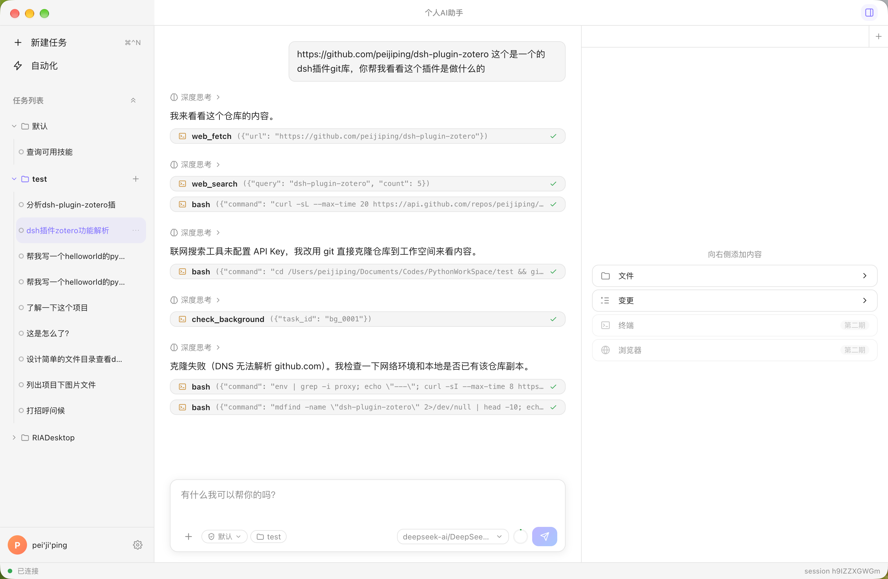

# TRAE 复刻桌面端 · 智能体工具

> 从一个「从 0 到 1 学习 Coding Agent Harness」的个人仓库，**转变为一个功能完整的桌面智能体工具**。
> 前端做壳，Python 后端做脑：所有 Agent 逻辑、工具执行、流式生成都在后端，前端只负责「渲染 + 交互 + 转发」。



<sub>桌面端实机截图（Electron + React 前端，Python Agent 后端）。</sub>

---

## 这个项目是什么

沿 **v1 → v2 → v2.1** 的学习脉络，我自研了一套 **OpenAI SDK 版 Coding Agent**，并统一改造为**流式输出**。
现在把这套智能体能力包装成一个 **Electron 桌面应用**，复刻 TraeWork 式的交互界面，并逐步补齐商用 Agent 桌面产品的核心能力。

**核心心法**：

> Agency（感知—推理—行动）来自模型训练，我们构建的是 **Harness** —— 让模型在特定领域里干活的脚手架。

**当前状态**：桌面壳 + 流式打字机 + 工具调用可视化已打通，并已具备 **多工作空间隔离、模型管理/热切换、会话管理（含回收站/归档）、token 统计与上下文指示、子智能体回放、任务面板、计划/目标执行模式、权限审批与沙盒隔离、附件/@引用/读图/多格式预览、右栏文件与变更面板、MCP/技能/插件管理、联网工具、统一日志**，可直接对话使用。

---

## 已实现能力

### 对话与执行
- **流式对话**：`thinking_delta`（可折叠思考）+ `content_delta`（打字机正文）+ `turn_end`（usage）逐字呈现
- **工具调用可视化**：工具名一出现即预测式展示折叠条，参数随流续写，完成后标注状态
- **并发会话**：每个会话独立 Agent 运行时（`SessionRuntime`），可同时后台执行；任务树切换会话**不断流**，事件按 `session_id` 路由 + 连接无关广播
- **停止请求**：会话级 `stop`，只停下当前正在执行的那一轮
- **断线自愈**：Python 子进程拉起监控 + WebSocket 指数退避重连 + 连接 Hub 广播（断线重连不丢运行中事件）+ 父进程孤儿看护

### 任务执行模式
- **计划模式（Plan）**：先产出可审阅的计划文书并写入工作空间，用户确认后再按计划执行；计划模式与目标模式在前端互斥切换，工作空间下拉框出现带关闭 × 的模式 tag
- **目标模式（Goal）**：设定目标后由独立评估器逐轮判定是否达成，未达成自动续跑，连续多轮未达成触发 limit 分支
- **用户确认选项（`ask_user`）**：模型在对话中抛出选项卡片，输入区让位、选择结果回填为工具结果继续执行

### 权限与安全
- **两档权限模式**：默认（逐项审批）/ 完全访问，对齐 WorkBuddy；会话 chip 与工作空间默认权限可分别设置
- **审批流**：范式 C 审批弹窗，静态分析工具参数（写文件/执行命令/删改等）后决定放行或询问，支持「本会话允许」记忆
- **权限管理设置页**：八分区规则配置，按命令/路径/工具粒度定制
- **沙盒隔离**：`run_bash` 经 `agents/sandbox.py` 执行隔离（macOS Seatbelt / Linux bwrap，其他平台降级裸跑），策略模板用户可编辑，配置热生效

### 文件与多模态
- **附件输入**：添加文件/图片，统一转换层（`doc_convert.py`）把 PDF / Office 转成模型可读内容
- **@ 引用**：输入框引用工作空间内文件与文件夹，气泡中渲染为胶囊 token，随消息回放
- **工具读图 / 统一读文件**：`run_read` 按类型分派，图片、复合文档（带图表/扫描页的 PDF、Office）都能按需进入上下文
- **多格式预览**：对话中出现的文件路径、`file://` 链接、@ 胶囊点开即在右栏独立 tab 只读预览（图片 / PDF / Word / Excel / PPT），目录则定位到右栏文件视图

### 右侧面板
- **文件 + 变更双视图**：文件树浏览与打开、git 变更列表；每个会话私有一份面板实例（开没开、标签、激活项、滚动位置随会话走）
- 终端 / 浏览器两项已预留契约与状态模型（第二期实现）

### 扩展生态
- **MCP 服务**：市场浏览与一键安装（默认本地包安装，钉版本 + 记录哈希）、手动添加、引用本机已启动服务、启停 / 测试 / 删除 / 工具清单；stdio / sse / streamable-http 三传输，配置按 mtime 热重载
- **技能**：多源市场聚合 + 手动新建，启停即时生效
- **插件**：兼容 Claude Code 插件规范（`marketplace.json` 即市场），市场安装、组件清单确认、启停 / 详情 / 删除；当前技能类组件已接入运行时
- **联网工具**：`web_search` + `web_fetch`，模型可主动检索与抓取网页正文

### 工作空间 / 多项目
- **多工作空间（多项目）**：选定目录 = 工具沙箱根 + 一份同构元数据目录（`~/.aigent/projects/<id>/`）；`projects.json` 索引 + `ws` 短码
- **隔离/共享清单**：会话/任务/记忆/团队/工作流按空间隔离，技能/MCP/模型配置/日志保持全局
- **侧边栏工作空间树**：default 固定第一、可折叠、**一键收起全部**、行内 `+` 新建任务、右键重命名/删除/在 Finder 打开、空间级运行与未读徽标、会话超 15 条自动折叠
- **输入框 chip 选择器**：两段式下拉 + 选择文件夹，新建任务归属所选空间
- **会话 id 跨空间查重**、删除守卫（仍有会话在跑拒绝删除）

### 模型与上下文
- **模型管理（设置弹窗）**：左「模型服务」列表 + 右连接详情；`llmconfig.json` v2 连接→模型两级配置；远端模型列表刷新；自定义供应商/模型；`providers.json` 预置目录与**热切换**（运行中会话同步生效）
- **会话级模型绑定**：每会话记录最后选择的模型 + 参数（思考强度/更大上下文），切换/回放自动恢复
- **token 统计与展示**：每轮 footer 两段式（本轮 + 本会话累计 + 缓存命中占比）；轮级 `usage` 落 jsonl、会话级 `usage_totals` 落元数据；子智能体（含后台迟到）一并计入
- **模型上下文指示**：切会话按该会话绑定模型 + 参数覆盖解析上下文窗口（圆圈 tooltip：上下文/累计输入/缓存命中/输出），修复了误用全局 1M 窗口的 bug
- **会话行悬停信息卡**：完整标题/所属项目/token 消耗/缓存命中率/最后更新

### 会话管理
- **会话生命周期**：新建/切换/清空/重命名/**归档（回收站）**/还原/批量永久删除
- **标题自动生成**：先取首条消息前 30 字为默认标题，首轮结束后 LLM 精炼 ≤20 字
- **回收站**：设置弹窗内全局视图（跨工作空间）、支持按工作空间筛选、多选批量删除
- **未读标记**：会话完成/切换时标记读/未读，跨窗口/重启生效

### 其它
- **子智能体执行回放**：执行过程旁路记录到独立文件（`session_<id>.subagents.jsonl`），切换会话时按 `tool_call_id` 挂到发起它的 assistant 消息下，实时与回放卡片位置不跳变
- **会话内任务面板**（TaskBoard）：`task_board` 幂等快照推送，实时推「进行中组」、重放只发未完成组；固定高度/可折叠，已结束组不回放
- **统一日志系统**：`~/.aigent/logs` 按日期分文件，后端 `DailyFileHandler` + 崩溃兜底，前端 logger 埋点
- **Markdown 渲染**：正文支持表格/代码块（`react-markdown` + GFM）
- **定时任务 / 队友协作 / MCP / 记忆**：后端模块齐备（`cron_scheduler` / `teammate_manager` / `mcp_manager` / `memories` / `context_compact`）

> 后续增量（附件多模态 / 账号 / 权限细化等）见 [开发路线图](docs/frontend/04-开发路线图与后续增量.md)。

---

## 技术框架

```
┌────────────────────────── Electron 桌面端 ──────────────────────────┐
│  渲染进程 (React UI)                                                  │
│    Sidebar(工作空间树·任务) │ ChatPanel(消息流/任务面板) │ InputBox │ 状态条 │
│    SettingsModal(通用/模型/归档/关于)                                   │
│    store(Zustand)      hooks(useAgentStream)                        │
│        ▲  contextBridge.invoke('agent:send') / on('agent:event')     │
│   preload.ts（contextBridge 白名单 API，contextIsolation 开启）        │
│        ▲  IPC                                                       │
│  主进程 (Main)                                                       │
│    pythonManager 拉起/监控/重启 Python 子进程                          │
│    agentWS 连后端 WebSocket + 指数退避重连 + 事件转发                   │
│    projectDirPicker 弹原生「选择文件夹」                               │
└──────────────┬──────────────────────────────────────────────────────┘
               │ 启动 ws_bridge.py（127.0.0.1:8765）
┌──────────────▼──────────────────────────────────────────────────────┐
│  Python 后端（OpenAI SDK）                                            │
│    agents/ws_bridge.py          桥：命令进 → Agent 方法调用，事件出 → 广播 │
│    agents/session_runtime.py    ⭐ 并发会话运行时（每会话独立 Agent）      │
│    agents/llm_config.py         模型配置（连接→模型两级 + 热切换）         │
│    agents/project_registry.py   多工作空间索引与隔离                     │
│    agents/session_manage.py     会话元数据 / 归档 / 回收站 / 子智能体记录  │
│    agents/permission.py        权限判定链 + 审批（approval.py）           │
│    agents/sandbox.py           沙盒执行隔离                             │
│    agents/execution_mode.py     计划 / 目标执行模式                      │
│    agents/streaming_client.py   StreamEvent / EventSink / WSSink       │
│    agents/agent_full_v2.py      Agent 引擎（run_turn / 会话 / 目标…）    │
└──────────────────────────────────────────────────────────────────────┘
```

### 技术选型

| 层面 | 选择 | 说明 |
|------|------|------|
| 桌面壳 | **Electron** | 渲染 + 主进程分离 |
| 语言 | **TypeScript** | 编译期类型安全 |
| UI | **React**（Hooks）+ **Zustand** | 数据驱动，贴流式渲染 |
| 构建 | **Vite + electron-vite** | 主 / 预加载 / 渲染三端一体化 |
| 样式 | 原生 CSS 变量（design tokens） | 轻量、无重型框架 |
| 通信 渲染↔主 | **contextBridge + ipcRenderer** | 白名单安全桥 |
| 通信 主↔Python | **WebSocket** + JSON 行协议 | 连接无关广播，断线不丢事件 |
| 状态 | Zustand store（agentStore 事件聚合） | 会话/工作空间/模型状态集中 |

> **为什么让主进程连 Python，而不是渲染进程直连？** WebSocket 是 Node 层的事，未来可能处理鉴权 / 重连 / 远端运行；渲染进程保持纯净，只经 `/agent API` 通信。

---

## 目录结构

```
learn-claude-code-main/
├── agents/                       # 🛠️ Python 后端（OpenAI SDK 流式版）
│   ├── agent_full_v2.py          # ⭐ Agent 引擎
│   ├── agent_cli.py              # CLI 入口（python agents/agent_cli.py）
│   ├── ws_bridge.py              # ⭐ 桌面薄桥：命令进、事件出
│   ├── session_runtime.py        # ⭐ 并发会话运行时（每会话独立 Agent）
│   ├── streaming_client.py       # 流式统一：StreamEvent / WSSink / consume_stream
│   ├── llm_config.py             # 模型配置（连接→模型两级 + 热切换）
│   ├── project_registry.py       # 多工作空间索引与隔离
│   ├── session_manage.py         # 会话元数据 / 回收站 / 子智能体记录
│   ├── subagent_store.py         # 子智能体旁路记录存储
│   ├── permission.py / approval.py  # 权限判定链 + 审批流
│   ├── sandbox.py                # 沙盒执行隔离（Seatbelt / bwrap）
│   ├── execution_mode.py         # 计划模式 / 目标模式
│   ├── attachments.py / doc_convert.py / refs.py  # 附件、文档转换、@ 引用
│   ├── mcp_manager.py / mcp_store.py / mcp_market.py / mcp_installer.py
│   ├── skills.py / skill_store.py / skill_market.py
│   ├── plugin_store.py / plugin_market.py
│   ├── web_tools.py              # 联网工具（web_search / web_fetch）
│   ├── tools.py                  # ToolRegistry（统一工具注册）
│   ├── task_manager.py           # 会话内任务面板
│   ├── cron_scheduler.py         # 定时任务
│   ├── teammate_manager.py       # 队友协作
│   ├── memories.py / context_compact.py / goal.py / workflow.py
│   ├── logger.py / config.py / paths.py / utils.py
│   └── ...
│
├── frontend/                     # 🖥️ Electron + React 桌面端
│   ├── src/main/                 #   主进程：pythonManager / agentWS / IPC / 目录选择
│   ├── src/preload/              #   contextBridge 白名单
│   ├── src/renderer/src/
│   │   ├── components/           #   Sidebar / Chat / RightPanel / Settings / TitleBar / common
│   │   ├── store/                #   Zustand：agentStore / sidebarStore / settingsStore
│   │   ├── hooks/                #   useAgentStream
│   │   ├── protocols/            #   事件线协议类型 / 解析
│   │   └── styles/               #   design tokens（色板/间距/字体）
│   └── devDeps: electron / electron-vite / vite
│
├── docs/frontend/                # 📐 桌面端设计与开发文档（协议 / 界面 / 模型 / 工作空间等）
├── anthropic/                    # ✅ v1 教程（只读）
├── anthropic_v2/                 # ✅ v2 教程（只读）
├── anthropic_v2.1/               # 🚧 v2.1 教程更新版（只读）
├── history/                      # 早期版本留档（流式版备份见 history/v2/openai流式版本/）
├── skills/ mcp_servers/ tests/   # 学习资源 / 本地 MCP 测试 / 单元测试
├── WorkSpace/                    # agent 跑过的实际任务留档
├── requirements.txt              # 后端依赖（含 openai / mcp / websockets）
└── README.md                     # 你正在读这个
```

运行期数据（会话历史、任务、子智能体记录、工作空间元数据、日志、配置）统一落在用户级 `~/.aigent/` 目录，不污染仓库。见 [05-配置与数据目录管理.md](docs/frontend/05-配置与数据目录管理.md)。

---

## 安装与运行

### 0. 前置

- **Python 3.13+**
- **Node.js 18+**（含 npm）

### 1. 后端（Python Agent）

```bash
pip install -r requirements.txt
cp .env.example .env     # 配置 OPENAI_MODEL_ID / OPENAI_API_KEY / OPENAI_BASE_URL
```

> 桌面端会自动拉起仓库根 `.venv/bin/python agents/ws_bridge.py`；若你没有 venv，请手动安装后端依赖后再运行（见上文）。
> 模型也可在**设置弹窗→模型**里配置并通过 `llmconfig.json` 热切换，不强制依赖 `.env` 单模型。

### 2. 桌面端（Electron）

```bash
cd frontend
npm install
npm run dev
```

> **国内网络**：若 Electron 二进制下载超时，设镜像后重装：
> `ELECTRON_MIRROR="https://npmmirror.com/mirrors/electron/" npm install`

`npm run dev` 会打开桌面窗口，主进程自动拉起 Python 桥并接通 `ws://127.0.0.1:8765`。
底部状态条显示连接状态；断线会自动重连。

### 3. 纯 CLI（不装桌面端时）

```bash
python agents/agent_cli.py
```

REPL 命令：直接输入对话；`/tasks` 任务看板 · `/compact` 压缩 · `/newsession` 新会话 · `/switchsession <id>` 切会话 · `/clearsession` 清空 · `/q` 退出。

---

## 一次对话的数据流

```
用户在输入框敲一句话
  → React InputBox → store.send(text, session_id, project_id, model, overrides)
  → preload window.agent.send(...)
  → 主进程 ipc 'agent:send' → agentWS.send({kind:'chat', ...})
  → Python ws_bridge → 取会话所属空间的 SessionManager
      → SessionRuntime.start_turn (独立 Agent，后台线程)
  → 事件按 session_id 路由 → WSSink 逐条 emit：thinking_delta / content_delta / tool_call_* / turn_end
  → ConnectionHub 广播到所有活跃连接 → 主进程转发 → useAgentStream 写进 agentStore
  → MessageList 因状态更新自动重渲染，界面逐字刷新
  → 首轮结束后 LLM 精炼标题，写回会话元数据
```

> 增量事件**只 append 不覆盖**，React 每次仅追加一小段文本，形成打字机效果。
> **会话独立后台执行**：`run_turn` 在后台线程跑，事件循环继续处理切换/其它会话/停止等命令，任意会话可后台执行、切换不断流。

---

## 通信协议（简）

同一条 WebSocket 上用 `kind` 区分消息：
- **事件（后端→前端）**：`{kind:'event', payload:{type:'content_delta', text:'…'}}`，类型与后端 `StreamEvent` 一一对应
- **命令（前端→后端），按组**：
  - 会话：`chat` / `stop` / `status_query` / `session_switch` / `session_set_unread` / `session_model` / `session_clear` / `session_rename` / `session_trash` / `session_restore` / `session_delete` / `sessions_list` / `trash_list`
  - 工作空间：`projects_list` / `project_add` / `project_open` / `project_rename` / `project_remove` / `project_permission`
  - 模型：`llm_config_get` / `llm_config_save` / `llm_models_fetch`
  - 执行与交互：`session_exec_mode` / `goal_status` / `plan_approve` / `plan_read` / `ask_answer` / `ask_cancel` / `approval_answer` / `session_permission`
  - 文件与右栏：`attachment_stage` / `refs_list` / `file_read` / `git_status` / `git_diff`
  - 安全与扩展：`permission_config_get/save` / `sandbox_config_get/save` / `mcp_*` / `skill_*` / `plugin_*`
  - 查询：`tasks` / `skills`
- **广播信封**：`sessions` / `projects` / `session_status` / `task_board` / `context_stats` / `permission_changed` 等

完整协议见 [docs/frontend/03-前后端通信协议.md](docs/frontend/03-前后端通信协议.md)。

---

## 设计文档索引（`docs/frontend/`）

| 文档 | 内容 |
|------|------|
| [00-README.md](docs/frontend/00-README.md) | 目录导航 + 术语对照 |
| [01-技术框架设计.md](docs/frontend/01-技术框架设计.md) | Electron 进程模型 / 选型 / 前后端边界 |
| [02-界面功能设计.md](docs/frontend/02-界面功能设计.md) | 三栏布局 / design tokens / 组件树 / token 统计 UI |
| [03-前后端通信协议.md](docs/frontend/03-前后端通信协议.md) | JSON 行协议 / IPC 通道 / 薄桥设计 / 事件线协议 |
| [04-开发路线图与后续增量.md](docs/frontend/04-开发路线图与后续增量.md) | P0–P4 分期 / 后续增量 / 已落地增量回填 |
| [05-配置与数据目录管理.md](docs/frontend/05-配置与数据目录管理.md) | `~/.aigent` 目录结构 / 分层优先级 / 密钥管理 / 分项目运行时数据 |
| [06-设置与模型管理.md](docs/frontend/06-设置与模型管理.md) | 设置弹窗 / 模型服务列表 + 连接详情 / `llmconfig.json` v2 |
| [07-会话管理与回收站.md](docs/frontend/07-会话管理与回收站.md) | 会话元数据 / 标题生成 / 悬停信息卡 / 归档与回收站 |
| [08-子智能体持久化与回放.md](docs/frontend/08-子智能体执行过程持久化与回放改造方案.md) | 子智能体旁路记录 / 回放挂载规则 |
| [09-日志系统.md](docs/frontend/09-日志系统.md) | `~/.aigent/logs` 统一日志 / 全量埋点 |
| [10-Task任务系统.md](docs/frontend/10-Task任务系统改造方案.md) | 会话内任务面板 / 存储布局 / 中断续跑 |
| [11-工作空间管理.md](docs/frontend/11-工作空间管理.md) | 多工作空间隔离 / 空间树 / `projects` 协议 |
| [12-附件与文件输入.md](docs/frontend/12-附件与文件输入.md) | 附件通道 / 统一文档转换 / 下载与回放 |
| [13-引用文件与文件夹（@-mention）.md](docs/frontend/13-引用文件与文件夹（@-mention）.md) | @ 引用 / 胶囊 token / 引用协议 |
| [14-工具读图（view_image）.md](docs/frontend/14-工具读图（view_image）.md) | 模型按需读图（入口已并入 `run_read`） |
| [15-统一文件读取（run_read 按类型分派）.md](docs/frontend/15-统一文件读取（run_read 按类型分派）.md) | 读文件工具收敛 / 复合文档读取 |
| [16-对话中的用户确认选项（ask_user）.md](docs/frontend/16-对话中的用户确认选项（ask_user）.md) | `ask_user` 工具 / 选项卡片 / 输入区让位 |
| [17-权限管控（两档模式与审批流）.md](docs/frontend/17-权限管控（两档模式与审批流）.md) | 两档权限 / 判定链 / 审批弹窗 |
| [18-权限管理设置页开发方案.md](docs/frontend/18-权限管理设置页开发方案.md) | 设置页八分区 / 读写与生效 |
| [19-右侧面板（文件与变更）.md](docs/frontend/19-右侧面板（文件与变更）.md) | 会话私有右栏 / 文件树 / git 变更 |
| [20-沙盒（执行隔离）.md](docs/frontend/20-沙盒（执行隔离）.md) | Seatbelt / bwrap / 策略模板 |
| [21-多格式文件预览.md](docs/frontend/21-多格式文件预览.md) | 图片 / PDF / Office 预览 / 路径点击 |
| [22-任务执行模式（计划与目标）.md](docs/frontend/22-任务执行模式（计划与目标）.md) | Plan / Goal 模式与互斥切换 |
| [23-MCP服务管理.md](docs/frontend/23-MCP服务管理.md) | MCP 市场 / 本地包安装 / 热重载 |
| [24-技能管理.md](docs/frontend/24-技能管理.md) | 多源市场 / 启停语义 |
| [25-插件管理.md](docs/frontend/25-插件管理.md) | Claude Code 插件规范兼容 / 组件清单 |
| [26-联网工具（web_search 与 web_fetch）.md](docs/frontend/26-联网工具（web_search 与 web_fetch）.md) | 联网检索与网页抓取 |

---

## 开发路线图

| 阶段 | 内容 | 状态 |
|------|------|------|
| P0 | electron-vite 骨架 + 三栏空布局 | ✅ |
| P1 | TraeWork 静态界面复刻（design tokens） | ✅ |
| P2 | 后端桥 + 流式打字机主链路 | ✅ |
| P3 | 工具调用可视化 + 断线重连 + 会话操作 | ✅ |
| P4 | 目标 / 待办 / 技能浅接入 | ✅ |
| 增量 · 模型管理 | `llmconfig.json` v2 + 热切换 + 会话级模型绑定 | ✅ |
| 增量 · 对话历史 | 会话元数据 / 重命名 / 归档回收站 / 回放 | ✅ |
| 增量 · token 统计 | 轮级+累计统计 / 上下文指示 / model_info 节点 | ✅ |
| 增量 · 多工作空间 | 项目隔离 / 空间树 / 会话跨空间唯一 | ✅ |
| 增量 · 任务面板 | 会话内 TaskBoard 实时推流与重放 | ✅ |
| 增量 · 子智能体回放 | 旁路记录 + 卡片回放 | ✅ |
| 增量 · 日志系统 | `~/.aigent/logs` 统一留痕 | ✅ |
| 增量 · 附件与引用 | 附件通道 / @ 引用 / 读图 / 统一 `run_read` | ✅ |
| 增量 · ask_user | 对话内选项卡片 | ✅ |
| 增量 · 权限管控 | 两档模式 / 审批流 / 设置页 | ✅ |
| 增量 · 沙盒 | Seatbelt / bwrap 执行隔离 | ✅ |
| 增量 · 右侧面板 | 文件 + 变更双视图 / 会话私有 | ✅ |
| 增量 · 多格式预览 | 图片 / PDF / Office 独立 tab 预览 | ✅ |
| 增量 · 任务执行模式 | 计划模式 / 目标模式 | ✅ |
| 增量 · 扩展生态 | MCP / 技能 / 插件管理与安装 | ✅ |
| 增量 · 联网工具 | `web_search` / `web_fetch` | ✅ |
| 后续 | 右栏终端与浏览器 / 账号 / 权限细化 | 🚩 增量 |

---

## 学习脉络（仓库由来）

这不是单纯的工程，而是一条学习轨迹：跟着 [shareAI-lab/learn-claude-code](https://github.com/shareAI-lab/learn-claude-code) 从 v1 → v2 → v2.1，**用 OpenAI SDK 自研复刻** Coding Agent 的核心机制。教程代码（`anthropic*`）只读留档，自己的实现（`agents/` + `frontend/`）持续演进。流式版早期快照见 [`history/v2/openai流式版本/`](history/v2/openai流式版本)。

---

> **Bash is all you need. Real agents are all the universe needs.**
>
> **这不是"抄源码"，是"抓住关键设计，自己造一遍"。**